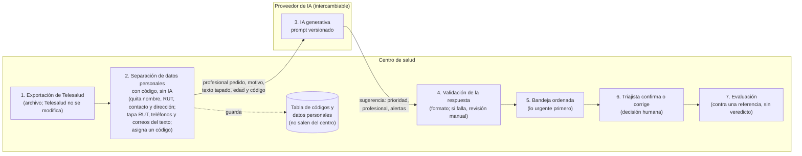

# Arquitectura de Pulso

Pulso es una **capa de apoyo** sobre la exportación de Telesalud: no escribe en Telesalud (regla R8) y la IA solo sugiere (regla R2). La pestaña "Cómo funciona" muestra este mismo recorrido.

**Diagrama tecnológico** (piezas del programa, frontera de privacidad y propuesta para el piloto): [arquitectura-pulso.html](arquitectura/arquitectura-pulso.html) · [imagen PNG](arquitectura/arquitectura-pulso.png). Ver la decisión 014.

## Qué viaja a la IA y qué no

- **Viaja**: profesional pedido, motivo, texto libre (con RUT, teléfonos y correos tapados) y edad, con un código en vez del ID.
- **No viaja**: nombre, RUT, contacto, dirección, columnas de funcionarios y notas, ni la tabla de códigos. Todo eso se queda en el centro de salud.
- El mapeo de las 48 columnas está en `src/schemas/exportacion-telesalud.js` (decisión 011).

## Piezas del código

| Paso | Dónde está |
|---|---|
| Leer la exportación | `src/repositories/bandeja.repository.js`, `src/utilidades/csv.js` |
| Separar datos personales | `src/services/seudonimizacion.service.js` |
| IA (adaptadores y modo simulado) | `src/adaptadores/`, `src/prompts/clasificacion.js` |
| Validar la respuesta | `src/schemas/clasificacion.schema.js`, `src/services/clasificacion.service.js` |
| Ordenar la bandeja | `src/services/bandeja.service.js` |
| Confirmar o corregir | `src/services/demo-bandeja.service.js`, `src/controllers/bandeja.controller.js` |
| Evaluar | `src/services/evaluacion.service.js`, `scripts/evaluar.js` |
| Pantalla | `public/` |

## En esta demostración

- Los datos son 100 % sintéticos. Lo único real es el encabezado de la exportación.
- Las sugerencias se **reproducen desde una corrida guardada** de MiniMax (no se llama a la IA en vivo durante el video).
